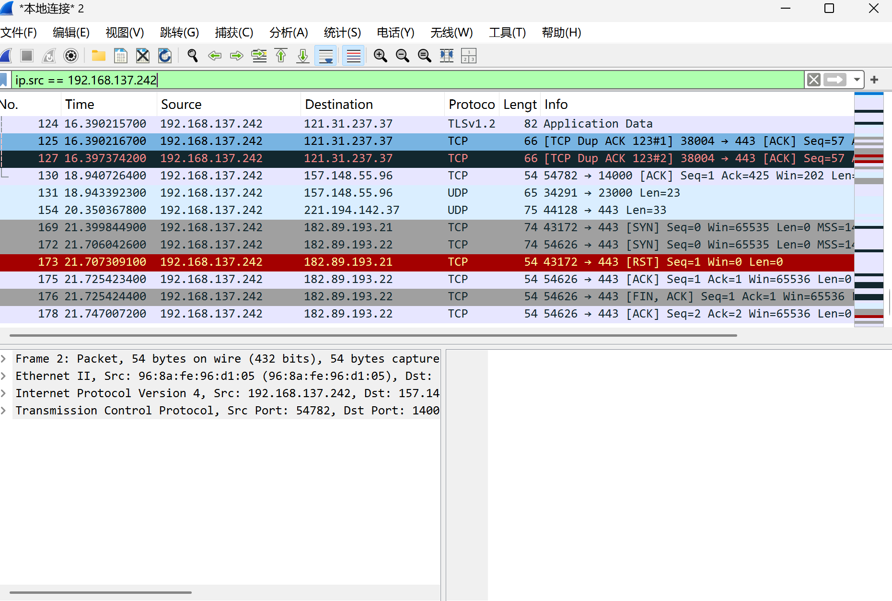

# moony-hub.github.io
# 25级信安网络渗透测试作业1：对等保2.0的理解

等保2.0全称网络安全等级保护2.0，国家标准为GB/T 22239-2019，以《中华人民共和国网络安全法》作为法律支撑，是我国网络安全等级保护制度的升级版。

对比旧版等保1.0，等保2.0的保护范围大幅扩展，覆盖云计算、物联网、工业控制系统、大数据平台等新型信息系统。整体安全框架采用**一个中心，三重防护**，兼顾技术防护体系与安全管理制度建设。

制度性质发生变化，从原来的指导性、自愿性要求，转变为法律层面的强制要求。网络运营者需要依次完成系统定级、备案、安全建设整改、等级测评工作，常态化保障网络与数据安全，落实网络运营主体的安全责任。

# 作业2：QQ流量分析
目的
使用Wireshark捕获手机QQ的网络流量，分析QQ所使用的传输协议，判断传输的数据是明文传输还是加密传输。
实验环境
•抓包主机：Windows操作系统，开启移动热点，抓包网卡：本地连接*2
•被测设备：手机，接入电脑热点，手机内网IP：192.168.137.242
•抓包工具：Wireshark 4.6.9
步骤
1.Windows系统打开移动热点，手机连接该热点，查看手机内网IP为192.168.137.242。
2.打开Wireshark，选择热点对应的网卡【本地连接*2】，点击开始捕获。
3.在显示过滤栏输入过滤规则：ip.src == 192.168.137.242，仅捕获手机发出的数据包。
4.手机端打开QQ，发送文字消息、图片，产生网络流量。
5.停止捕获，观察Wireshark中的数据包，分析协议类型与数据载荷。
结果分析
1.传输协议：TCP与UDP（QUIC）混合使用
本次抓包捕获到两种传输协议。
•TCP流量：大量TCP数据包，目的端口为443（TLS端口）。数据包中可以看到PSH,ACK标志位。PSH表示推送，代表手机QQ向腾讯服务器推送业务数据；ACK是TCP确认应答，保证数据可靠传输。手机上传图片、文字消息主要使用TCP承载TLS加密数据。
•QUIC流量：同时捕获到QUIC协议包，QUIC底层基于UDP，同样用于QQ的数据传输。
即使QQ空闲、没有收发消息，客户端也会持续向腾讯服务器发送心跳包，维持在线连接，所以Wireshark数据包列表会持续不断新增数据包。

2.传输方式：加密传输，非明文
抓到的数据包包含TLSv1.3 Application Data、QUIC Payload (Encrypted)。IP地址、端口这类头部信息明文可见，但消息、图片等应用载荷全部经过TLS/QUIC加密。
选中数据包右键追踪TCP流，打开后内容是十六进制密文乱码，无法直接读取聊天文字、图片内容。

结论
QQ采用**TCP+UDP(QUIC)**混合传输，业务数据全程加密。对比Telnet协议：Telnet使用TCP明文传输，抓包可以直接读取账号密码；而QQ业务载荷加密，局域网第三方抓包只能获取IP、端口、流量大小等外层网络信息，无法直接窃取聊天与图片内容，可以保护用户的隐私信息。
