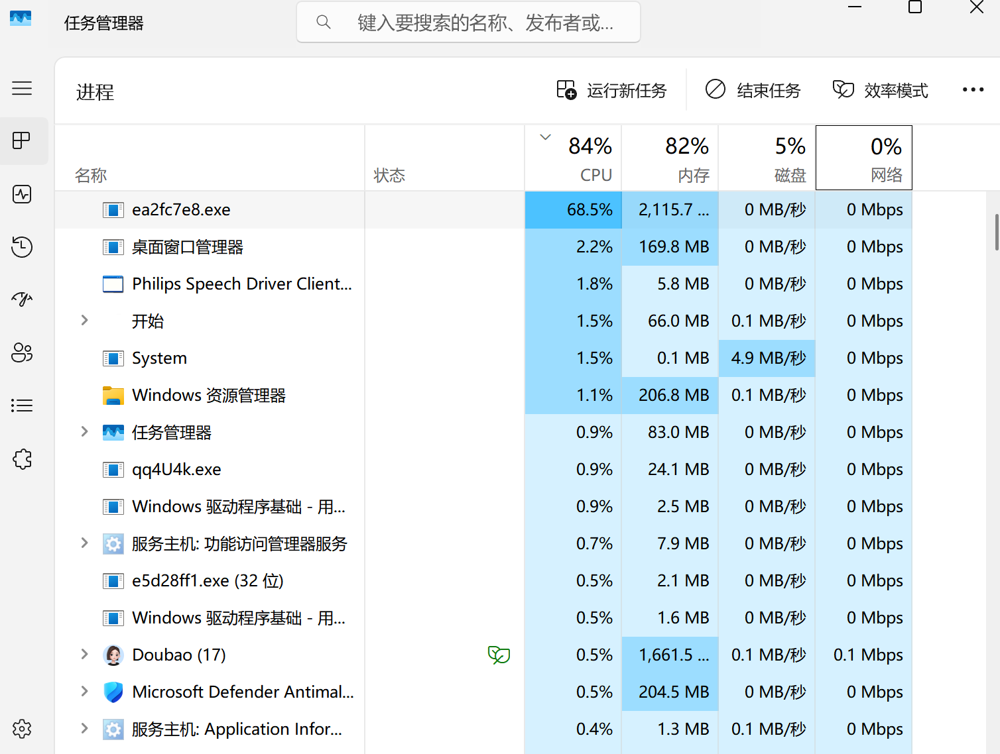
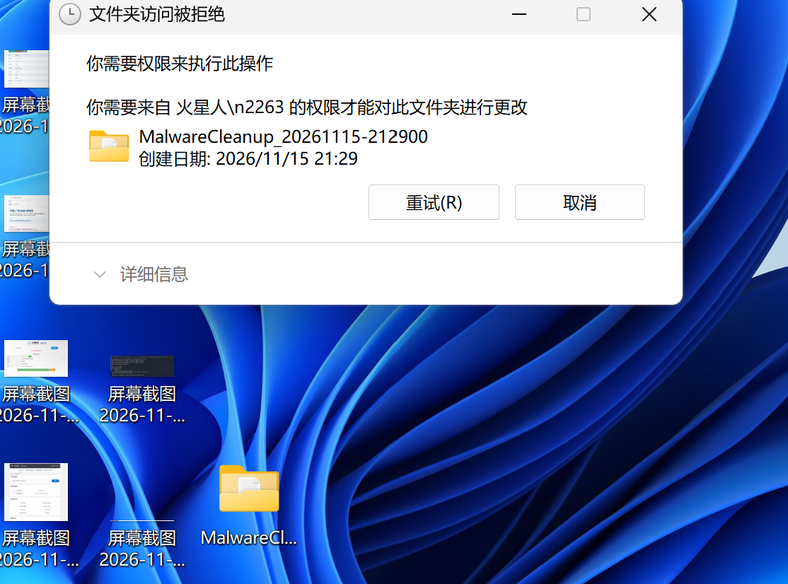
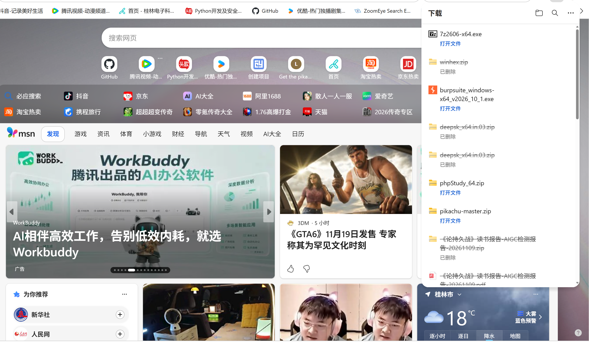
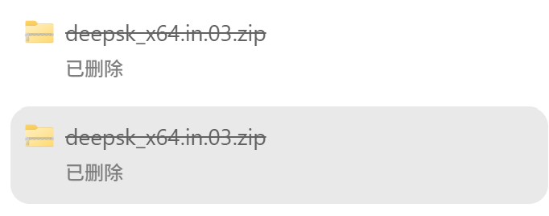

十一月中旬的一个晚上，笔记本风扇突然开始持续高转。摸了一下键盘，温度明显不对。打开任务管理器，CPU 占用 84%，排第一的进程叫 `ea2fc7e8.exe`，一个完全随机命名的东西，吃掉 68.5% 的 CPU 和 2 GB 内存。

作为信息安全专业的学生，第一反应不是"该清灰了"，而是——这玩意儿我不认识。

<!--more-->

## 一、第一现场



```
ea2fc7e8.exe        68.5%  2,115.7 MB
桌面窗口管理器        2.2%
Philips Speech...    1.8%
```

几个不和谐的地方：

- 进程名是 8 位十六进制随机串，正常软件不会这么命名
- 一个 664 KB 的程序占 2 GB 内存，说明它在内存里解包了远大于自身的载荷
- 同一时间还有 `qq4U4k.exe`、`e5d28ff1.exe` 这种同款随机命名

先定位文件：

```powershell
Get-CimInstance Win32_Process -Filter "Name='ea2fc7e8.exe'" |
  Select-Object ProcessId, ParentProcessId, ExecutablePath, CommandLine
```

结果指向 `C:\ProgramData\96636554\ea2fc7e8.exe`，一个纯数字命名的隐藏目录。

## 二、顺藤摸瓜：注册表里的"安全中心"

查自启项，`HKLM\SOFTWARE\Microsoft\Windows\CurrentVersion\Run` 里赫然躺着两条：

```
Tencent SecurityHealth  = "C:\Users\Public\4J23So\qq4U4k.exe"
Alibaba SecurityHealtha = "C:\Program Files (x86)\TMIkZa\TMIkZa.exe"
```

名字起得很有欺骗性——腾讯安全中心、阿里安全中心。但路径暴露了：

- `C:\Users\Public\4J23So\` —— Public 下的 6 位随机目录
- `C:\Program Files (x86)\TMIkZa\` —— Program Files 下的随机目录

进去看内容，四个目录，创建时间全部集中在 **2026-11-12 19:32–22:36**：

```
C:\Users\Public\4J23So\        qq4U4k.exe, UxEnhance64.dll, adoresd.dat, msadox.tb
C:\Program Files (x86)\TMIkZa\ TMIkZa.exe, XPSPLOG.dll, image.png, thumbs.db
C:\Program Files (x86)\Rqbv27\ Q31LDhdwN.exe, XPSPLOG.dll, image.png, thumbs.db
C:\Program Files (x86)\XKgWlG\ jmrR1r.exe
```

## 三、第一个意外：合法签名的"壳"

最初以为是"随机命名的 exe 就是病毒"，但查签名发现完全不是这么回事：

```powershell
Get-AuthenticodeSignature 'C:\Users\Public\4J23So\qq4U4k.exe'
# Status: Valid
# Signer: CN=Tencent Technology (Shenzhen) Company Limited

Get-AuthenticodeSignature 'C:\Program Files (x86)\TMIkZa\TMIkZa.exe'
# Status: Valid
# Signer: CN=Speech Processing Solutions GmbH（飞利浦语音）
```

exe 是**真的腾讯、真的飞利浦程序**，签名有效。但同目录下的 DLL 没有签名：

```
UxEnhance64.dll   NotSigned
XPSPLOG.dll       NotSigned
```

进一步对比发现，`TMIkZa.exe`、`Rqbv27\Q31LDhdwN.exe`、`XKgWlG\jmrR1r.exe` 三个文件的 SHA256 **完全相同**——同一个合法程序被复制成三个随机名字。

这是典型的 **DLL 侧加载（DLL Sideloading）**：拿一个签过名的合法 exe 当外壳，因为它会按默认搜索顺序从自己所在目录加载同名 DLL，攻击者只要把恶意 DLL 放在旁边，就能让恶意代码以"可信进程"的身份运行。

用 Python 解析导入表后，链条彻底清楚了：

```
qq4U4k.exe (x64, 腾讯签名)
  └─ 导入 UxEnhance64.dll!?EnableUxEnhance@@YA_NXZ
                       !?DisableUxEnhance@@YA_NXZ
        └─ UxEnhance64.dll (x64, 无签名, 加壳)
```

导出函数名伪装成"启用/禁用界面增强"，C++ 修饰符 `@@YA_NXZ` 表示返回 bool、无参数，看起来完全人畜无害。

## 四、第二个意外：杀软早就被架空了

既然是挖矿，为什么 Defender 三天没反应？查服务状态：

```powershell
Get-Service WinDefend
# Status: Stopped
sc.exe start WinDefend
# [SC] StartService 失败 4551: 应用程序控制策略已阻止此文件。
```

错误码 4551 是 **WDAC（Windows Defender Application Control）** 在拦截。翻事件日志：

```
Code Integrity determined that services.exe attempted to load
...\MsMpEng.exe that did not meet the Custom 3 / Antimalware
signing level requirements or violated code integrity policy
(Policy ID:{a244370e-44c9-4c06-b551-f6016e563076})
```

顺着策略 ID 找到文件：

```
C:\Windows\System32\CodeIntegrity\SiPolicy.p7b
  创建时间: 2026-11-12 19:34:13   ← 正是感染当晚
  签名状态: UnknownError（无签名）
  策略 ID: {a244370e-44c9-4c06-b551-f6016e563076}
```

**攻击者往系统里塞了一份恶意 WDAC 策略，在驱动加载层禁止 Defender 的引擎启动。** 这比关服务、改注册表都狠——它是内核级、开机加载的。

重启后策略消失（文件已删），Defender 恢复 Running。但还有第二个坑在等着：

## 五、第三个意外：9 条被篡改的排除项

Defender 起来之后，第一件事是看它的扫描范围：

```powershell
Get-MpPreference | Select-Object -ExpandProperty ExclusionPath
```

```
C:\
C:\Program Files (x86)
C:\ProgramData
C:\Users
C:\Program Files (x86)\Rqbv27
C:\Users\Public\4J23So
C:\Users\n2263\Documents
...
```

**整个 C 盘都被排除在扫描之外**，其中两条还精确点名了恶意目录。

这才是它能活三天的根本原因：第一天用 PowerShell 脚本给自己加白（`VirTool:PowerShell/ExcludeProc.A`，被 AMSI 拦了 4 次但排除项还是写进去了），第二步用 WDAC 把引擎按死，第三步把扫描范围清空。

## 六、意外之四：一个内核驱动服务

翻系统日志时，发现感染当晚有一条 7045（服务安装）事件：

```
2026-11-12 19:34:03  服务已安装到系统
  服务名称: TCLService
  服务文件名: C:\Windows\Temp\ranchserv.jpg
  服务类型: 内核模式驱动程序
  启动类型: 自动
```

一个叫 `.jpg` 的内核驱动，服务名 `TCLService`，启动类型自动。

查文件属性：

```
大小: 28,272 字节
签名: Valid
签名者: CN=Adlice, O=Adlice, L=Orvault, C=FR   ← 法国 RogueKiller 杀软的公司
状态: STOPPED，退出码 0x800b010c
```

这是 **BYOVD（Bring Your Own Vulnerable Driver）**：拿厂商签过名的驱动（通常有已知漏洞或较强的内核操作能力），改名伪装成图片塞进 `C:\Windows\Temp`，注册成系统服务，目的是拿到内核权限去对抗安全软件。

所幸证书链校验失败（`0x800b010c`），驱动从没真正加载起来。

## 七、清除

清理时踩了个坑——桌面上放隔离文件夹，删不掉：



ACL 显示当前用户和 Administrators 都是完全控制，但所有删除操作都返回"拒绝访问"。原因是 `WdFilter` 这个文件系统过滤驱动：Defender 把文件判定为威胁后，会在内核层锁住它，防止执行或篡改。

最后走管理员权限 + 计划任务 + 注册表三条线一起清：

```powershell
# 1. 删自启
Remove-ItemProperty 'HKLM:\SOFTWARE\Microsoft\Windows\CurrentVersion\Run' -Name 'Tencent SecurityHealth'

# 2. 删计划任务（伪装成 Edge 更新）
Unregister-ScheduledTask -TaskName 'MicrosoftEdgeUpdateTaskUA Task-S-1-5-18 NDefa' -Confirm:$false
Unregister-ScheduledTask -TaskName 'SN0sX' -Confirm:$false
Unregister-ScheduledTask -TaskName 'Deadlines Management System Powerful' -Confirm:$false

# 3. 隔离目录
Move-Item 'C:\Users\Public\4J23So' 'D:\quarantine\' -Force

# 4. 删驱动服务
sc.exe delete TCLService

# 5. 清排除项
Remove-MpPreference -ExclusionPath 'C:\'
```

五个伪装成 `MicrosoftEdgeUpdateTaskUA...` 的计划任务是被任务计划程序服务拉起来的——这也解释了为什么之前只删文件会"复活"，父进程是 `svchost.exe -k netsvcs`（Task Scheduler）。

## 八、溯源：一张下载记录

病毒从哪来？翻 Prefetch：

```
2026-11-12 19:31:19  DEEPSK_X64.IN.03.EXE
2026-11-12 19:32:01  → C:\Users\Public\4J23So\qq4U4k.exe 落地
2026-11-12 19:33:07  → adoresd.dat 落地
2026-11-12 19:34:03  → 安装 TCLService 驱动
2026-11-12 19:34:13  → 写入 SiPolicy.p7b
```

从双击到全套植入完成，**2 分 54 秒**。

再翻 Edge 的下载数据库（`History` 是个 SQLite，`downloads` 表里有完整来源）：



```
target: D:\edge\deepsk_x64.in.03.zip
tab_url: https://deepseeek.org/          ← 三个 e
tab_referrer_url: https://cn.bing.com/   ← 从 Bing 点进来的
url: https://deepseeek.org/go/event?type=download&t=...
```

把 URL 里的 token base64 解码：

```json
{
  "s": "adcdc060-cea3-4476-89e8-2adeb45f1965",
  "n": "download", "k": "download", "l": "立即下载",
  "u": "https://www.kop4r.com/dsorg",
  "e": 1797076229
}
```

一个完整的广告投放追踪系统。域名对比：

```
官方：deepseek.com      （2 个 e）
钓鱼：deepseeek.org     （3 个 e）
```

用户搜索"deepseek 官网"，点了 Bing 广告位的假站，下载了一个 3.3 MB 的"安装包"——真正的桌面版有 289 MB，这个体积只够装一个投递器。



## 九、静态分析：加壳、PNG 容器与 C2

用纯 Python 写了个 PE 解析器（不依赖 pefile），几个发现：

**1. 四个恶意 PE 用同一套壳**

| 特征 | 值 |
|---|---|
| 随机节名 | `.bd*` `.2a<` `.`ES` `.V>q` `.MqH` `.caA` |
| 单一大高熵节 | 4–5 MB，熵 7.90–7.99 |
| 导入表 | 每个 DLL 只导入 1 个函数 |
| 时间戳 | `e5d28ff1.exe` 为 0（1970） |
| 入口点 | `e8 76 d5 dc ff 56 48 be 8e 4a 9d ce...` 非合法指令 |

**2. 三份"图片"其实是数据容器**

```
[PNG头 8B][IHDR 25B][pHYs 21B][IDAT 1405B][IEND 12B]  ← 1483 字节的真图片（96×96）
[4.76 MB 加密数据]                                     ← IEND 之后追加
```

一张 96×96 的图标不可能有 5 MB。

**3. C2 明文藏在调色板里**

`thumbs.db`（512×512 调色板 PNG）的 PLTE 区偏移 `0x180`：

```
GG.HH.HH.GG.33. 47.238.85.63 ......GG.HH..G..Gf. Fzauxss.net ......c..GG.HH.GG.HH. H10Y-03
```

| 类型 | 值 | 归属 |
|---|---|---|
| IP | `47.238.85.63` | 47.238.0.0/16，Alibaba Cloud HK |
| 域名 | `Fzauxss.net` | 同一条配置 |
| 域名 | `3Dcoreaction.com` | 内嵌于 UxEnhance64.dll |
| 标识 | `H10Y-03` | 疑似批次号 |

改调色板只会让缩略图颜色轻微失真，图片仍能正常解码——一个很取巧的隐写位置。

## 十、复盘：木马、病毒、蠕虫、挖矿

排查过程中反复想到一个问题：这到底算什么"毒"？

| 类型 | 是否自我复制 | 传播方式 | 需要用户操作 |
|---|---|---|---|
| 病毒 Virus | 是（感染宿主文件） | 随被感染文件传播 | 需要 |
| 蠕虫 Worm | 是（独立复制） | 扫漏洞、试弱口令 | 不需要 |
| 木马 Trojan | 否 | 伪装成正常软件 | 需要 |
| 挖矿 Miner | 否 | 不是传播方式，是载荷 | 看载体 |

严格说这四个**不在同一维度**："病毒/蠕虫"描述传播方式，"木马"描述欺骗方式，"挖矿"描述目的。

这次的情况是：**木马投递的挖矿载荷**。它不感染其他文件（不是病毒），不自扫描内网（不是蠕虫），靠的是"让你以为在下 DeepSeek"。

## 十一、攻击链映射（ATT&CK）

| 阶段 | 技术 | 本例对应 |
|---|---|---|
| Initial Access | T1189 Drive-by Compromise | Bing 广告 → 仿冒站 |
| Execution | T1204 User Execution | 双击假安装包 |
| Defense Evasion | T1574.002 DLL Side-Loading | 腾讯/飞利浦 exe + 无签名 DLL |
| Defense Evasion | T1553.006 Code Signing Policy Modification | SiPolicy.p7b 恶意 WDAC |
| Defense Evasion | T1562.001 Disable or Modify Tools | 9 条 Defender 排除项 |
| Defense Evasion | T1068 Exploitation for Privilege Escalation | Adlice 驱动（BYOVD，未成功） |
| Persistence | T1053.005 Scheduled Task | 5 个伪装 Edge 更新的任务 |
| Persistence | T1543.003 Windows Service | TCLService 内核驱动 |
| Command and Control | T1071 Application Layer Protocol | 47.238.85.63 / Fzauxss.net |
| Impact | T1496 Resource Hijacking | CoinMiner |

## 十二、给同类环境的建议

1. **下载源只认官方域名**。`deepseek.com` 和 `download.deepseek.com`，任何多一个字母的变体都是假的。搜索引擎的广告位不验证域名真伪。
2. **签名不等于安全**。这次四个恶意组件里，三个宿主 exe 的签名完全有效。真正该看的是"这个签名程序为什么会加载一个无签名 DLL"。
3. **关注 `C:\Windows\Temp` 和 `C:\ProgramData` 下的随机命名**。正常软件不会用 8 位十六进制命名目录。
4. **定期检查 WDAC 策略和 Defender 排除项**：
   ```powershell
   Get-ChildItem 'C:\Windows\System32\CodeIntegrity' -Force
   Get-MpPreference | Select-Object -ExpandProperty ExclusionPath
   ```
5. **爆破工具和白帽工具单独放虚拟机**。这台机器上有 Burp、Goby、IDA、Kali、phpStudy、pikachu，还有 `ja-netfilter` 这种激活补丁——本身就是高危环境，任何来路不明的 exe 都应该先在 VM 里跑。

---

## 附：IOC 清单

| 类型 | 值 |
|---|---|
| 域名 | `deepseeek.org`（仿冒官网） |
| 域名 | `kop4r.com`（广告落地页） |
| IP | `47.238.85.63`（C2，阿里云香港） |
| 域名 | `Fzauxss.net`（C2） |
| 域名 | `3Dcoreaction.com`（备用 C2） |
| 文件 | `deepsk_x64.in.03.zip` / `deepsk_x64.in.03.exe` |
| 文件 | `ea2fc7e8.exe`（Trojan:Win64/CoinMiner.PA） |
| 文件 | `UxEnhance64.dll`、`XPSPLOG.dll`、`adoresd.dat`、`msadox.tb` |
| 服务 | `TCLService` → `C:\Windows\Temp\ranchserv.jpg` |
| 路径 | `C:\Users\Public\<6位随机>\`、`C:\Program Files (x86)\<6位随机>\`、`C:\ProgramData\<8位数字>\` |

---

*本文记录的是真实发生在自己机器上的一次事件，分析方法以静态分析为主（样本加壳，未做动态脱壳）。文中所有命令均在本人设备上执行。*
