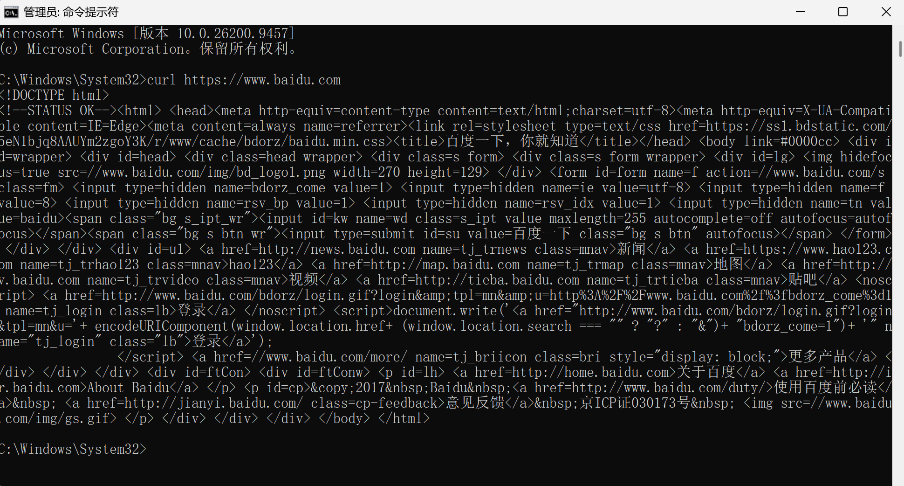
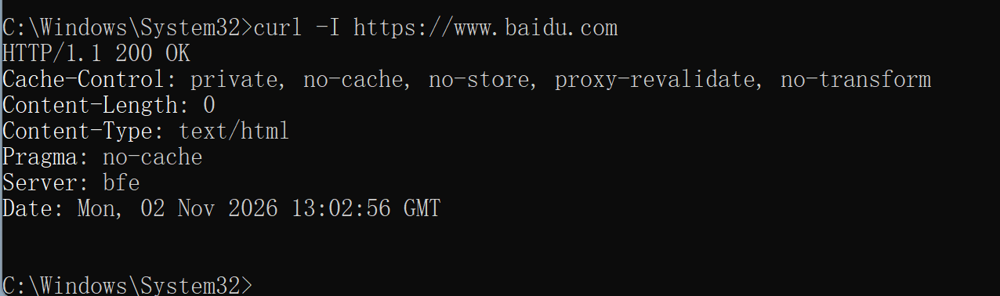
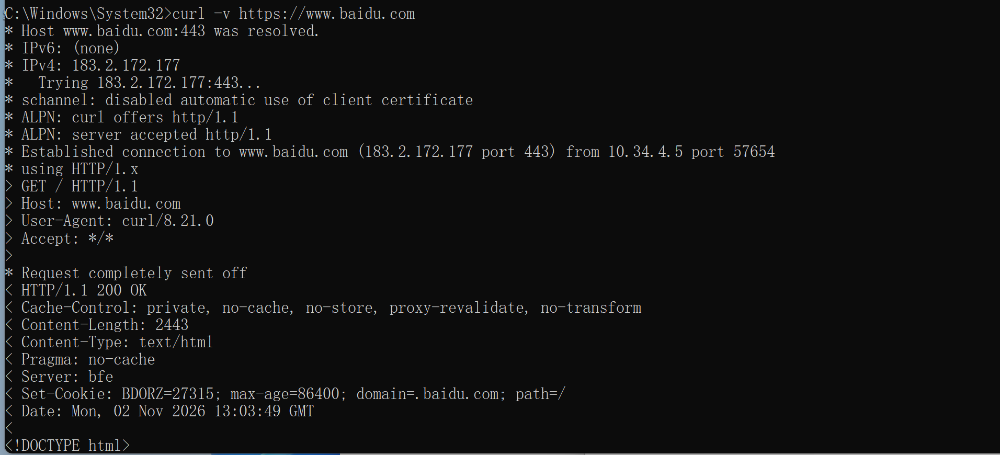

curl 是操作系统自带的**命令行网络请求工具**，可以在不打开浏览器的情况下，手动发起 HTTP、HTTPS、FTP 等网络请求，是网络调试、协议学习、接口测试最基础、最核心的工具。本次实验通过 curl 实操，直观理解网页访问、响应状态码、请求头、服务器响应信息等网络基础原理。

<!--more-->

## 一、curl 工具介绍

curl（Client URL）是一款跨平台命令行数据传输工具，Windows10/11、Linux、macOS 均**系统自带、无需安装**。

与浏览器访问网页不同：
- 浏览器：图形化展示网页结果，隐藏底层通信细节
- curl：**展示原始网络数据流**，可以清晰看到请求、响应、协议版本、头部信息、加密握手过程

支持协议：HTTP、HTTPS、FTP、SFTP、TLS、SSL 等数十种网络协议。

常用于：
- 网络连通性测试
- HTTP/HTTPS 协议学习
- 查看网站响应头、状态码
- 接口调试、服务器排查故障
- 自动化脚本网络请求

## 二、本次实验常用 curl 参数

| 参数 | 作用 |
|-----|------|
| 无参数 | 获取网页完整 HTML 源码 |
| `-I`（大写i） | 只获取**响应头**，不下载页面内容 |
| `-v` | 详细模式，展示 TCP 连接、TLS 握手、完整请求交互过程 |

## 三、实操一：基础网页请求（获取源码）

执行命令：
```bash
curl [https://www.baidu.com](https://www.baidu.com)
```

效果：
终端直接输出百度首页的完整 HTML 源代码。

原理：
curl 向百度服务器发起 HTTP GET 请求，服务器接收请求后返回网页源码，终端直接打印原始数据。

## 四、实操二：查看网站响应头（核心实验）

执行命令：
```bash
curl -I [https://www.baidu.com](https://www.baidu.com)
```

该命令仅发送 HEAD 请求，**只获取服务器响应头部**，返回简洁、标准、适合网络学习的信息。

可观察到内容：
- HTTP 协议版本
- 响应状态码 `200 OK`（请求成功）
- 服务器类型、缓存机制
- 页面编码、跳转策略

该实验可以直观验证：**正常网站 HTTPS 服务在线、端口正常、服务响应稳定**。

## 五、实操三：详细模式分析完整网络流程

执行命令：
```bash
curl -v [https://www.baidu.com](https://www.baidu.com)
```

`-v` 详细模式可以完整展示一次 HTTPS 访问的全过程：
1. DNS 解析域名
2. 建立 TCP 连接
3. TLS/SSL 加密握手
4. 发送 HTTP 请求
5. 接收服务器响应
6. 关闭连接

非常适合理解 **HTTPS 加密通信全过程**。

## 六、实验总结

- curl 是最基础的网络命令行工具，可以脱离浏览器直接操作网络协议。
- 通过 `-I` 参数可以快速判断网站存活、响应状态、服务器信息。
- 通过 `-v` 参数可以观察完整 TCP、TLS 握手流程，加深对加密传输原理的理解。
- 浏览器访问网页是封装后的可视化结果，curl 可以看到**最原始的网络交互数据**，适合网络原理学习与故障排查。

> 安全声明：本次所有 curl 操作仅用于合法、公开、可访问的公共网站教学实验，禁止对未授权服务器进行批量请求、压力测试、恶意探测等违规行为。
