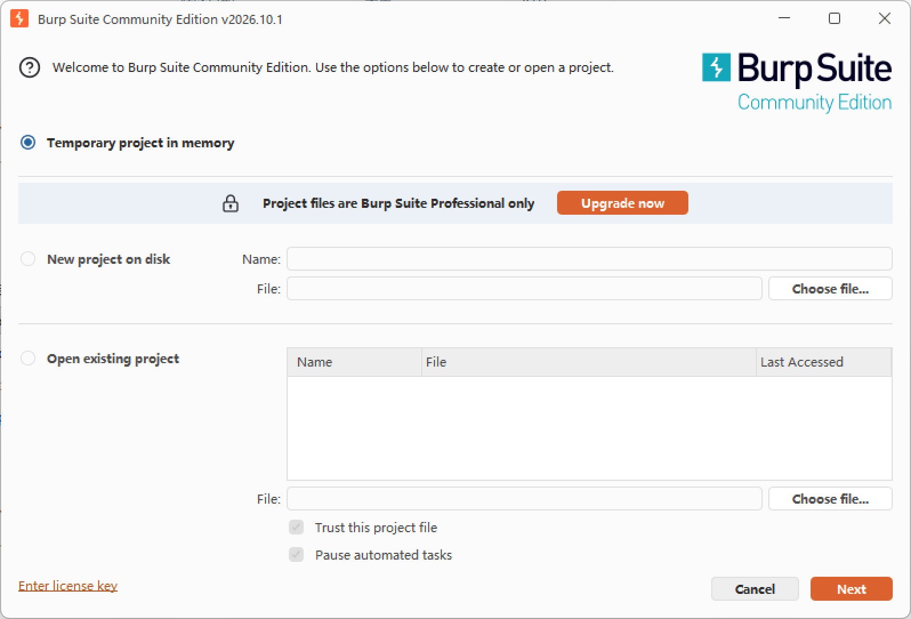
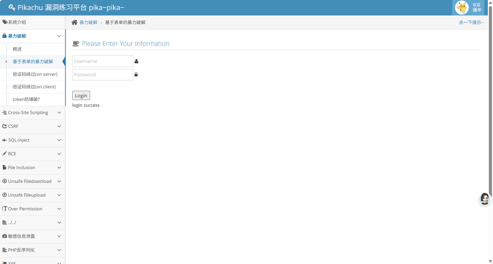
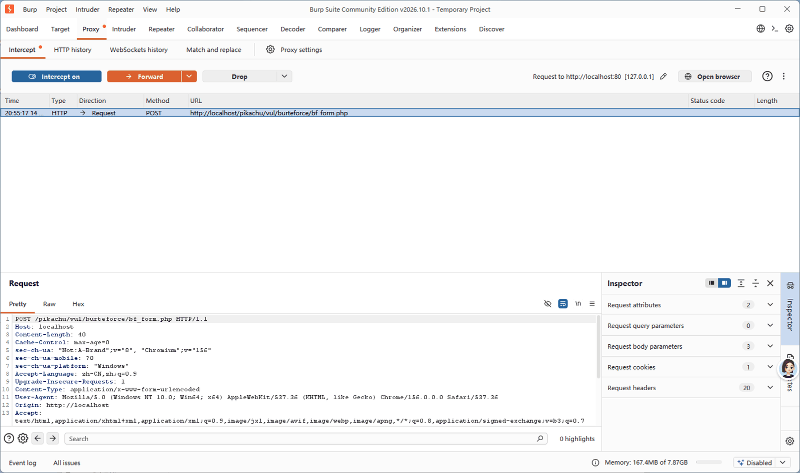
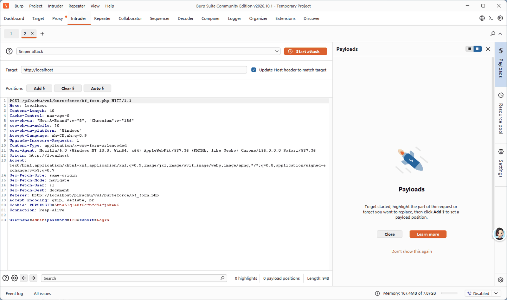
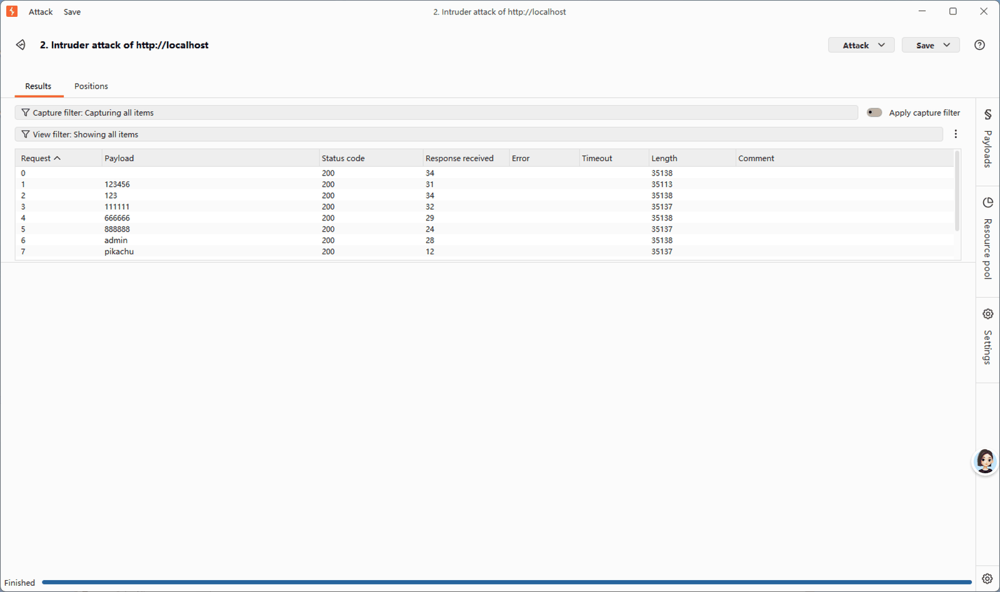
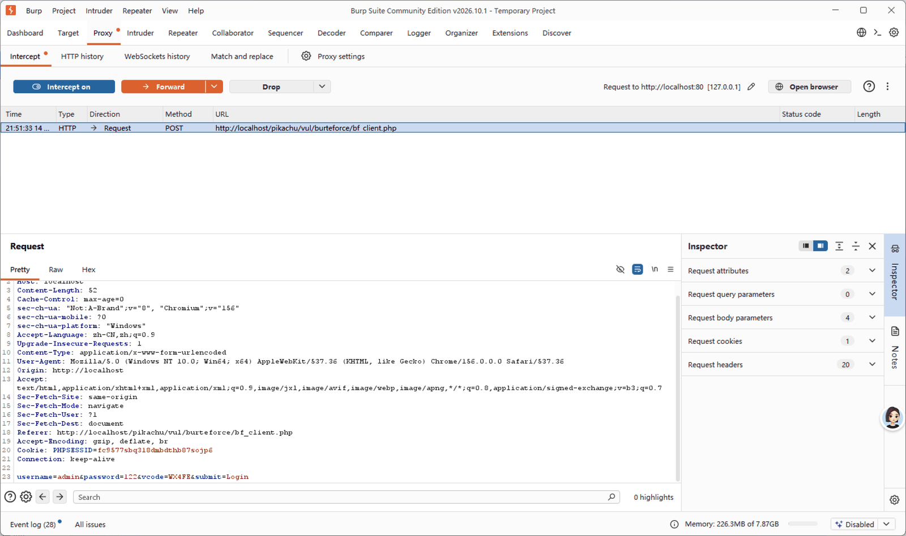
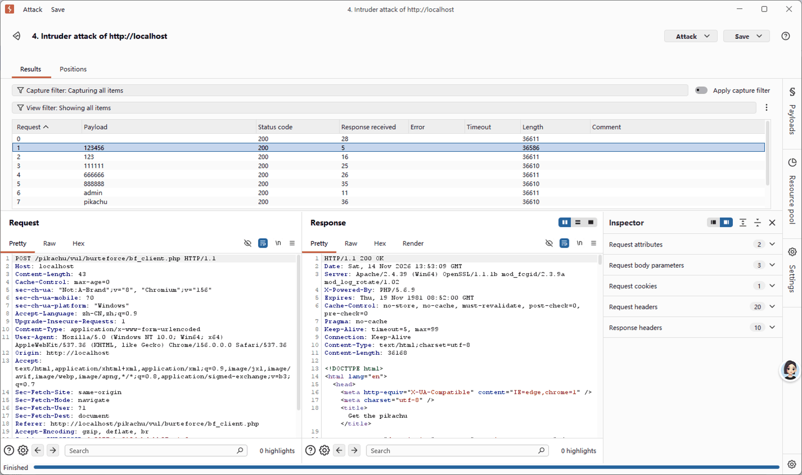
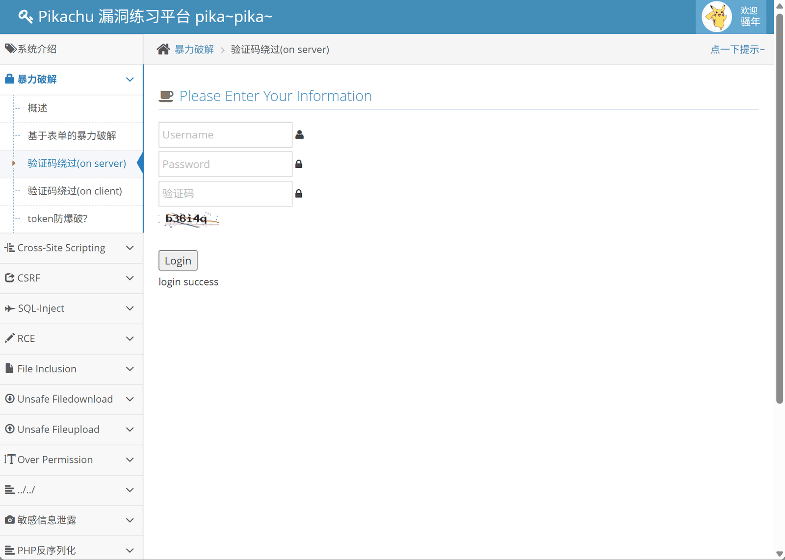
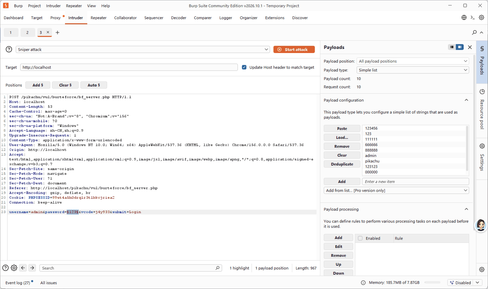

这篇文章记录了一次完整的本地练习过程：搭好 Pikachu 靶场，装好 Burp Suite 社区版，然后把暴力破解模块的四道关卡依次打完。内容全部在本地 localhost 环境下完成。

> 安全声明：以下所有操作仅在自己的本地环境、自己搭建的靶场上进行。未授权的渗透测试属于违法行为，不要对任何非本人所有的站点抓包、爆破或测试。

<!--more-->

## 一、环境准备

- 系统：Windows
- 集成环境：phpStudy（小皮面板），提供 Apache + MySQL
- PHP 版本：5.6（7+ 会大量报错，务必切换）
- 工具：Burp Suite Community Edition（社区免费版）
- 靶场源码：Pikachu（皮卡丘）Web 漏洞练习平台

## 二、Pikachu 靶场搭建

### 1. 源码放置

下载 ZIP 压缩包后解压，把内层真正的源码（index.php、inc 文件夹同级目录）复制到 phpStudy 的 `WWW/pikachu` 目录下。

⚠️ 常见坑：不要带着外层 `pikachu-master` 文件夹一起放，否则路径错乱访问 404。

### 2. 修改数据库配置

打开文件：`pikachu/inc/config.inc.php`

按照 phpStudy 中 MySQL 的账号密码进行修改，保存文件。

### 3. 初始化安装

1. phpStudy 启动 Apache 和 MySQL
2. 浏览器访问：`http://localhost/pikachu/install.php`
3. 点击【安装 / 初始化】
4. 提示“数据库连接成功！新建数据库 pikachu 成功！”即搭建完成，点击进入首页

### 4. 靶场包含的漏洞模块

- 暴力破解（表单爆破、服务端验证码绕过、前端 JS 验证码绕过）
- XSS（反射型 get/post、存储型、DOM XSS）
- CSRF（跨站请求伪造）
- SQL 注入（字符型、数字型、insert/update 注入、盲注等）
- RCE（命令执行）
- 文件包含、文件上传、不安全文件下载、目录遍历、XXE、SSRF 等

新手推荐练习顺序：

暴力破解 → XSS 反射型 → SQL 注入字符型 → 文件上传 → RCE / SSRF / XXE

## 三、Burp Suite 安装与基础配置

Burp Suite 是 Web 渗透测试行业主流的抓包与漏洞测试工具，核心作用是拦截、查看、修改、重放、爆破 HTTP 数据包。

### 1. 版本选择

- **Community（社区版，免费）**：自带 Proxy 抓包、Repeater 重放、Decoder 编码解码；Intruder 爆破有请求数量限制，新手练习完全够用
- Professional（专业版，付费）：完整爆破、自动扫描、插件商店
- Enterprise（企业版）：公司自动化扫描使用

### 2. 安装步骤

1. 官网下载 Burp Suite Community Edition
2. 双击 exe 一路下一步安装
3. 首次打开选择 **Temporary project** → Next

4. 选择 **Use Burp Defaults** → Start Burp

### 3. 两种抓包方式

#### 方式一：自带浏览器（新手首选，零配置）

在 Proxy 标签页点击 **Open browser**，Burp 会弹出一个已经配置好代理的内置浏览器，无需手动设置代理、无需安装证书，直接访问靶场即可抓包。

#### 方式二：本机浏览器 + SwitchyOmega 插件

1. 浏览器扩展商店安装 Proxy SwitchyOmega
2. 新建情景模式，代理协议 HTTP，服务器 `127.0.0.1`，端口 `8080`
3. 保存并切换到该情景模式
4. Burp → Proxy → Settings 确认 `127.0.0.1:8080` 处于 running 状态

### 4. 新手必学四个核心模块

- **Proxy（代理）**：拦截浏览器发出的 HTTP 请求，可查看和修改
- **Intruder（爆破器）**：给参数打标记，批量替换字典内容发包，用于暴力破解
- **Repeater（重放器）**：手动修改 payload 反复提交，适合调试 XSS、SQL 注入
- **Decoder（编码解码）**：URL 编码、Base64、HTML 转义等快速转换

## 四、暴力破解模块通关详解

### 第 1 关：基于表单的暴力破解

访问地址：`/pikachu/vul/burteforce/bf_form.php`

已知用户名为 `admin`，只需爆破密码。

操作步骤：

1. Burp 开启拦截，页面输入 `admin / 123` 点击登录
2. 抓到 POST 包后右键 → **Send to Intruder**

3. 进入 Intruder → Positions，点击 **Clear §** 清空所有标记
4. 只给 password 参数的值两侧加上 § 标记

5. 切换到 Payloads 标签页，加载弱口令密码字典
6. Options 中配置 Grep - Match，添加关键词“用户名或密码错误”
7. 点击 **Start attack** 开始爆破
8. 爆破结果中，响应长度明显不同的那条即为正确密码

本关正确账号密码：`admin / 123456`

### 第 2 关：验证码绕过（on client）

特点：验证码校验逻辑只在前端 JS 中执行，后端不校验验证码参数。

绕过方法：抓包后直接修改或删除验证码参数，即可正常进行爆破，无需关注页面上的验证码图片。

### 第 3 关：验证码绕过（on server）

特点：验证码在服务端校验，但校验通过后没有销毁 session 里的验证码，同一个验证码可以反复提交。

思路：先把图片上的验证码填对再抓包，之后固定 `vcode` 不变，只爆破 password；爆破过程中不要刷新页面、不要点验证码图片，否则 session 里的验证码一换，包里的 vcode 立即失效。

## 五、高频踩坑清单

| 问题现象 | 常见原因 | 解决方法 |
| :--- | :--- | :--- |
| 页面大量报错 | PHP 版本过高 | 切换到 PHP 5.6 |
| 数据库连接失败 | config.inc.php 账号密码不匹配 | 对照 phpStudy 的 MySQL 配置修改 |
| 访问 404 | 源码多套了一层文件夹 | 把内层源码直接放到 pikachu 目录 |
| 页面空白功能失效 | 未执行 install.php 初始化 | 访问 install.php 重新安装 |
| payload 被拦截 | 浏览器安全插件过滤 | 关闭插件或使用干净的浏览器环境 |
| Burp 抓不到包 | 代理未切换 / 监听端口不一致 | 检查 SwitchyOmega 和 Burp 监听设置 |

## 六、后续练习路线

暴力破解模块通关后，推荐按以下顺序继续练习：

1. XSS 反射型（get）→ 理解 payload 构造与弹窗
2. XSS 反射型（post）、存储型 XSS
3. SQL 注入字符型 get/post → 手工注入、union 查询、报错注入
4. 文件上传 → 前端校验绕过、MIME 绕过、后缀绕过
5. RCE、SSRF、XXE 等进阶漏洞
