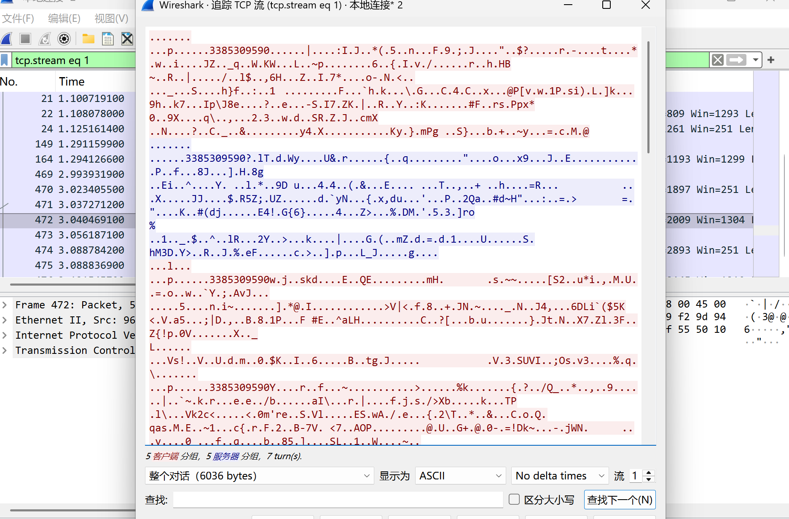

---
title: "Wireshark 抓包：手机 QQ 的聊天内容到底加密了吗"
date: 2026-10-13
slug: qq-traffic-analysis
description: "一台 Windows 笔记本开热点，手机连上去聊几句，再用 Wireshark 看看 QQ 走的是 TCP 还是 QUIC，抓到的载荷能不能直接读出来。"
image: cover.png
categories:
    - 流量分析
tags:
    - Wireshark
    - QUIC
    - TLS
    - 协议分析
---

作业要求很简单：抓一段手机 QQ 的流量，看它用什么协议传数据，判断是明文还是加密。整个过程十分钟能做完，但结论比想象中干净——**除了 IP、端口这些外层信息，应用层载荷全都是加密的**。

<!--more-->

## 实验环境

| 项目 | 配置 |
| --- | --- |
| 抓包主机 | Windows，开启移动热点 |
| 抓包网卡 | `本地连接*2`（热点对应网卡） |
| 被测设备 | 手机，接入热点，内网 IP `192.168.137.242` |
| 抓包工具 | Wireshark 4.6.9 |

## 抓包步骤

1. Windows 打开「移动热点」，手机连上，确认手机的内网 IP 是 `192.168.137.242`。
2. 打开 Wireshark，选中热点网卡 `本地连接*2`，开始捕获。
3. 在显示过滤器里只保留手机发出的包：

   ```text
   ip.src == 192.168.137.242
   ```

4. 手机端打开 QQ，发几条文字和图片。
5. 停止捕获，观察协议类型与载荷内容。

## 结果分析

### 1. 传输协议：TCP 与 UDP（QUIC）混合

抓到的包里两种传输方式同时存在：

- **TCP**：大量目的端口为 `443` 的 TCP 包，能看到 `PSH, ACK` 标志位。`PSH` 表示把数据推给对端，`ACK` 是确认应答，说明手机在向腾讯服务器推送业务数据。上传图片、文字主要走 TCP 承载的 TLS。
- **UDP**：抓到了目的端口 `443` 的 UDP 包，对应 **QUIC** 协议（QUIC 基于 UDP，自带加密与多路复用）。另外还有 UDP `14000` 端口的流量，属于腾讯自有协议族，多用于探测与保活。


即使不聊天、不发消息，手机 QQ 也会持续向服务器发送心跳包维持在线，所以包列表会一直增加——这是抓包时很容易注意到的现象。

### 2. 传输方式：全程加密，没有明文

关键看应用层载荷：

- 抓到的应用层数据标记为 **TLSv1.2 Application Data**，QUIC 部分是 **Encrypted Payload**，都不是明文。
- IP 头、TCP/UDP 头、端口号这些外层信息当然可见，但消息正文、图片内容全部在 TLS/QUIC 的加密隧道里。
- 选中一个包右键 **追踪 TCP 流（Follow → TCP Stream）**，看到的是大段十六进制乱码和不可读字符，没有任何可识别的聊天文字。



## 结论

| 判断项 | 结果 |
| --- | --- |
| 传输协议 | TCP + UDP（QUIC）混合 |
| 应用层载荷 | TLS / QUIC 加密，非明文 |
| 可获取的信息 | IP、端口、包长、时序等元数据 |
| 能否窃取聊天内容 | 局域网抓包无法直接还原 |

对比 Telnet 这类明文协议——抓包能直接看到账号密码和全部交互内容。QQ 的业务数据全程加密，同一个局域网里的第三方即使抓到包，也只能拿到 IP、端口、流量大小这类外层网络信息，无法直接窃取聊天文字与图片。

## 顺带总结：3 步判断一个协议是否加密

1. 看协议列：出现 `TLS`、`SSL`、`QUIC`、`Encrypted` 字样，基本就是加密流量。
2. 追踪流看内容：明文协议（HTTP、FTP、Telnet、SMTP）能直接读出可打印字符。
3. 看端口只是辅助：443 常见但不是绝对，真正可靠的是"追踪流里能不能读懂"。

> 本文为课程作业《QQ 流量分析》的整理版本，截图来自本人实测抓包。
